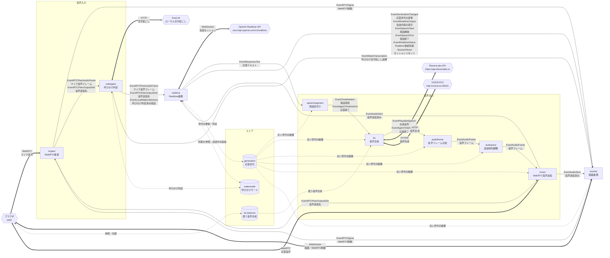
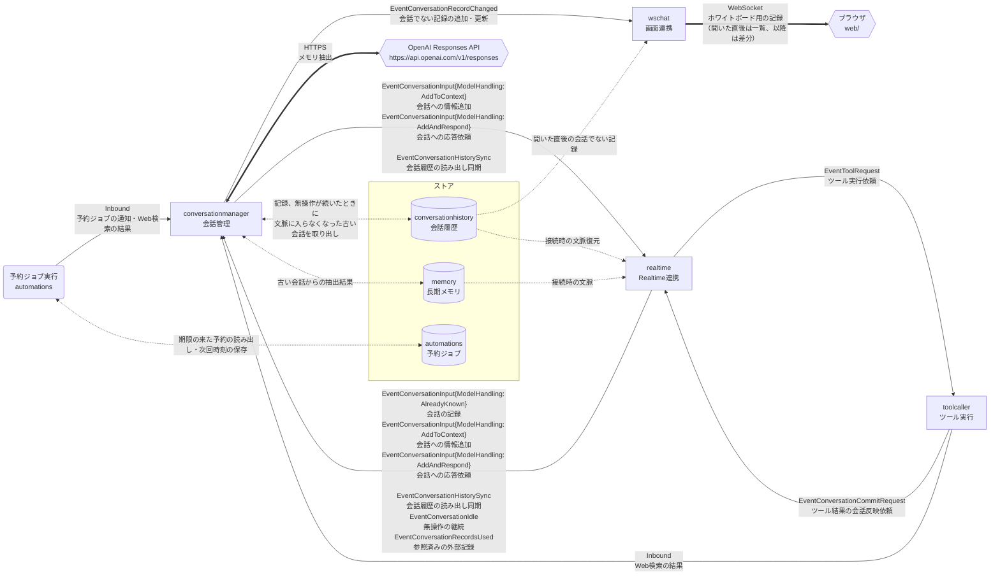
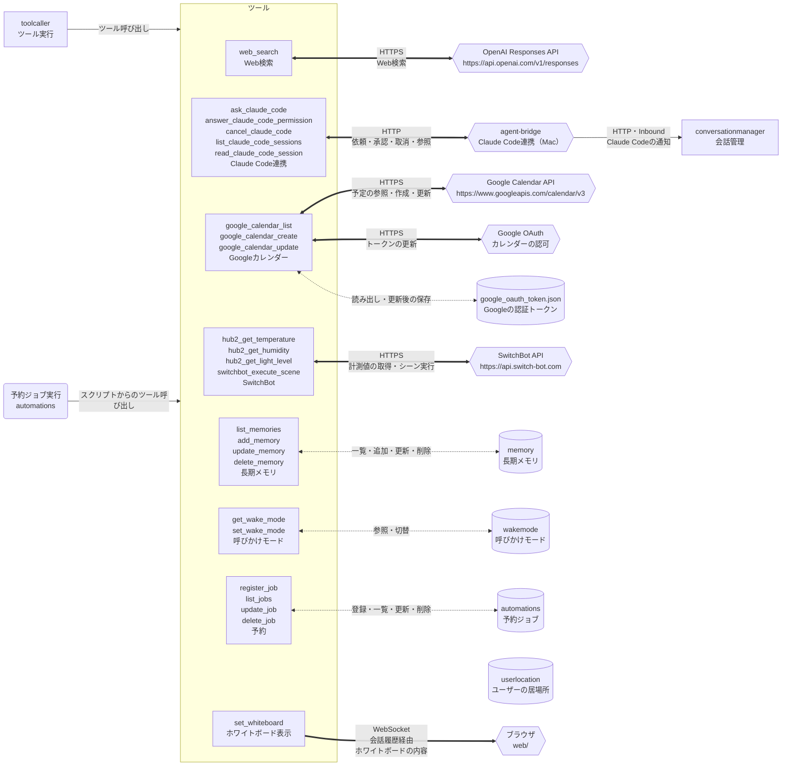

# smart-speaker

スマートフォンのブラウザを音声入力・音声再生の端末として使う、Web ベースのスマートスピーカーです。

ブラウザのマイク音声を WebRTC で Go サーバーへ送り、サーバーが OpenAI の Realtime API と会話します。
返答のテキストは VOICEVOX（または ElevenLabs）で音声にして、WebRTC でブラウザへ返して再生します。

## 主な機能

- 音声での会話。話しはじめると、読み上げ中の返答を止めて聞き取ります
- ホワイトボード：調べた結果や補足を画面に書き出します
- 外部サービスの操作：Google Calendar の予定の確認・登録、SwitchBot での家電操作、Web 検索
- 長期メモリ：会話から覚えておくことを抽出し、次の会話で使います。「覚えて」「忘れて」と頼むか、AIの提案に了承すると、その場で追加・変更・削除します（画面からも確認・編集できます）
- 予約ジョブ：「10分後に起こして」「平日8時に〜して」などと会話から登録できます
- 呼びかけ必須モード：「起きて」などの呼びかけで始まる発話だけに反応します
- 手元の Mac の Claude Code に、調べものや文章作成などの作業を頼めます

## すぐに起動する

```sh
cp config.sample.yaml config.yaml
export OPENAI_API_KEY=...
docker compose up --build
```

`http://localhost:5173` を開きます。
設定や外部サービスとの連携は、下の手順書を参照してください。

## 手順書

- [セットアップとローカル起動](docs/setup.md)：設定、起動、テスト、外部サービス連携の設定
- [本番環境へのデプロイ](docs/deploy.md)
- [agent-bridge](services/agent-bridge/README.md)：Claude Code 連携のために Mac で常駐させるブリッジ

設定の全項目と既定値は [config.sample.yaml](config.sample.yaml) にあります。

## ディレクトリ構成

| パス | 内容 |
|---|---|
| `cmd/smart-speaker` | サーバーの起動処理と HTTP API |
| `cmd/local-verify-realtime` | 外部 API を使わずに動かす確認用のサーバー |
| `internal/` | 会話処理（`components/realtime` など）、ツール（`tools/`）、状態の保存（`states/`） |
| `web/` | ブラウザの画面（React） |
| `services/local-stt` | 呼びかけ判定に使うローカルの文字起こし（faster-whisper） |
| `services/agent-bridge` | Claude Code 連携のブリッジ |
| `scripts/` | デプロイなどのスクリプト |

## コンポーネントとデータの流れ

細い実線はイベントと Inbound、太線は外部との通信、点線はストアの読み書きを表します。

### 音声の流れ



### 会話



### ツール


