# Smart Speaker アーキテクチャ

この文書は `smart-speaker` の現在の会話処理の構成を説明する。
会話の中心は OpenAI Realtime API で、`internal/components/realtime` が API との接続・応答生成の制御・ツール呼び出しの仲介をまとめて担う。
音声合成以降は、読み上げ単位への分割、音声合成、フレーム化、送信タイミング調整、WebRTC 送信を別々の component が担う。

構成は `cmd/smart-speaker/main.go` の `buildStages`（各 component の生成）と `wireGraph`（component 間の接続）で決まる。

## 全体像

```mermaid
flowchart LR
  Browser{{"ブラウザ<br/>Web UI、マイク入力、音声再生"}}
  API{{"OpenAI Realtime API"}}

  WS["wschat<br/>WebSocketでUI向けJSONとgraph eventを変換"]
  PEER["rtcpeer<br/>WebRTC signaling、上り音声のdecode"]
  WAKE["wakegate<br/>呼びかけ必須モード中だけ音声を止め、<br/>ローカルSTTで呼びかけを判定する"]
  RT["realtime<br/>API接続、応答生成の制御、<br/>履歴記録、ツール呼び出しの仲介"]
  SEG["speechsegment<br/>応答テキストを読み上げ単位に分割"]
  TTS["tts<br/>VOICEVOX / ElevenLabs で音声化"]
  FRAME["audioframe<br/>24kHz PCM16を20ms単位に分割"]
  PACE["audiopace<br/>フレームの送信時刻を調整"]
  OUT["rtcout<br/>Opusに変換してWebRTCで送信"]
  TOOL["toolcaller<br/>local toolを実行"]

  Browser <-.->|"/ws/chat"| WS
  Browser <-.->|"WebRTC音声"| PEER
  WS <-->|"EventRTCSignal"| PEER
  PEER -->|"EventRTCPeerAudioFrame<br/>EventRTCPeerOutputSink"| WAKE
  WAKE -->|"音声フレーム、接続状態、<br/>EventLocalWakeUtterance"| RT
  RT <-.->|"WebSocket"| API
  RT -->|"EventResponseText"| SEG
  SEG -->|"EventTimelineItem"| TTS
  TTS -->|"EventPlayableSpeech"| FRAME
  FRAME -->|"EventAudioFrame"| PACE
  PACE -->|"EventAudioFrame"| OUT
  OUT -->|"EventAudioSent"| RT
  OUT -->|"EventAudioSent"| WS
  PEER -->|"EventRTCPeerOutputSink"| OUT
  RT -->|"EventToolRequest"| TOOL
  TOOL -->|"EventConversationCommitRequest<br/>（ツール結果）"| RT
  TOOL -->|"EventWhiteboardUpdate"| WS
  RT -->|"世代変更、表示テキスト、発話開始/終了、<br/>接続状態、EventSessionReset"| WS
  WAKE -->|"EventWakeTranscription<br/>（書き起こしと判定）"| WS
```

## 主要な責務

- `wschat` はブラウザとの WebSocket 境界。チャット表示、WebRTC signaling、発話状態、セッションリセット、ホワイトボード更新を JSON でやり取りする。
- `rtcpeer` は WebRTC の signaling と peer の管理、上り音声（Opus）の decode、下り音声の送信先の通知を担う。
- `wakegate` は呼びかけ必須モードの間だけ、音声を realtime へ渡さず、ローカルSTT（`local-stt` サービス）で呼びかけを判定する。通過した発話は `EventLocalWakeUtterance` としてテキストで渡す。書き起こしと判定の結果は、拒否・破棄したものも含めて `EventWakeTranscription` として wschat へ渡し、画面のログ管理画面に出す。呼びかけ不要モードや呼びかけ後の会話中は、音声をそのまま通す。詳細は [呼びかけ必須モードの仕様](wake-mode.md)。
- `realtime` は会話の中心。主な責務は次のとおり。
  - Realtime API との WebSocket 接続・切断・55分ごとの張り直しと、`session.update`（モデル、VAD、文字起こしモデル、ツール定義、システムプロンプト）の送信
  - 再接続時に、会話履歴の要約と長期メモリをシステムプロンプトの後ろに付けて文脈を復元する
  - マイク音声を 24kHz・モノラル PCM16 に変換して API へ送る
  - API 内蔵の VAD による発話開始で世代を進め、古い応答の読み上げを止める
  - API の自動応答は使わず、入力確定などの条件がそろったときに `response.create` を送る。応答はテキストだけで受け取り、音声合成は後段に任せる
  - 割り込みで途中までしか読み上げられなかった応答は、API 側の会話履歴を「中断された」形に書き換えてから次の応答を作る
  - ユーザー発話（非同期の文字起こし）、アシスタントの発言、ツール呼び出しと結果を会話履歴に記録する
  - function call を `EventToolRequest` として `toolcaller` に渡し、結果を API に返す。`wait_for_user` は自身で処理する
  - 呼びかけ必須モードの制御、予約ジョブの実行、無操作時のセッションリセット
- `speechsegment` は応答テキストの差分を受け取り、句点などで読み上げ単位に分割して `EventTimelineItem` にする。応答の終わりで `EventAgentTimelineEnd` を出す。
- `tts` は読み上げ単位を、選択中の provider（既定は VOICEVOX）で音声化する。provider は `config.yaml` の `tts.provider` と、画面からの切り替え（`GET` / `PUT /api/tts`）で決まる。
- `audioframe` は 24kHz・モノラル PCM16 を 20ms 単位のフレームに分割し、`audiopace` が1フレームずつ送信時刻を進め、`rtcout` が 48kHz の Opus に変換して WebRTC で送る。送信したフレームは `EventAudioSent` として realtime と wschat に通知する。realtime は、実際に送信できたテキストを割り込み時の履歴補正に使う。
- `toolcaller` は registry に登録された local tool の handler を実行し、結果を `EventConversationCommitRequest` として realtime へ戻す。ホワイトボード更新は `wschat` へ直接流す。

## 世代と割り込み

世代idは `internal/states/generation` が保持し、`internal/components/generationcontroller` を通して realtime が進める。
ユーザーが話し始めたとき（API の `input_audio_buffer.speech_started`）、テキスト入力を受けたとき、接続が切れたときに新しい世代を始め、`EventGenerationChanged` を流す。

後段の `speechsegment`、`tts`、`audioframe`、`audiopace`、`rtcout`、`wschat` には、`generationfilter.Attach` で受信直後の世代判定を付けている。
現在の世代ではない event は、処理本体に入る前に捨てられるため、各 component は世代を意識せずに処理できる。
`toolcaller` には `generationfilter.AttachToolRequests` を付けている。古い世代のツール要求は実行せず、「実行前に中断された」という結果を realtime へ返す。

## 会話履歴とメモリ

会話履歴は `internal/states/conversationhistory` が保持し、realtime が記録する。
Realtime API との接続を張り直すときは、この履歴を Responses API で要約し（`conversation.ContextBuilder`）、システムプロンプトの後ろに付けて文脈を復元する。

長期メモリは `internal/states/memory` が JSON ファイルに保存する。
接続時には `internal/hooks/memory` の `ContextProvider` が保存済みメモリを文脈として渡す。
会話終了時には、realtime が会話履歴を取り出し、`CreatorHook.ExecRecords` で保存済みメモリと会話を LLM に渡して、メモリの追加・更新・削除を反映する。詳細は [メモリ機能](hooks/memory.md)。

## Tool 呼び出し

ツールは Realtime API の function calling で呼び出す。
ツール定義は `internal/tools/registry` が組み立て（`DefinitionsForRealtime`）、`session.update` で API に渡す。
API が function call を返すと、realtime がそれを `EventToolRequest` として `toolcaller` に渡し、`toolcaller` が handler を実行して結果を返す。
realtime は結果を会話履歴に記録し、`function_call_output` として API に返す。

各ツールには、成功後に再び応答を生成するかと、そのときの追加指示（`tools.DefinitionWithResponsePolicy`）を設定できる。
`web_search` も同じ経路の local tool で、handler の内部で Responses API の hosted `web_search` を別の request として呼ぶ。

## セッションリセット

最後の発話から `config.yaml` の `conversation.idle_timeout_seconds`（既定 1800 秒、0 で無効）がたつと、realtime がセッションをリセットする。
判定は realtime の定期処理（`tick`）で行い、応答中・ツール実行中・未送信の音声がある間はリセットしない。

リセット時は、会話履歴を取り出して空にし、取り出した履歴でメモリ抽出を別 goroutine で起動する。
そのうえで `EventSessionReset` を `wschat` へ流し、Realtime API との接続を張り直す。
`wschat` は WebSocket の `session_reset` メッセージとしてブラウザに配信し、UI は直近の会話の吹き出しを消す。

## 参照元

- `cmd/smart-speaker/main.go`
- `internal/graph/graph.go`
- `internal/types/event.go`
- `internal/components/realtime/`
- `internal/components/wakegate/`
- `internal/components/speechsegment/stage.go`
- `internal/components/tts/`
- `internal/components/audioframe/stage.go`
- `internal/components/audiopace/stage.go`
- `internal/components/rtcout/`
- `internal/components/rtcpeer/`
- `internal/components/toolcaller/toolcaller.go`
- `internal/components/generationfilter/connection.go`
- `internal/components/generationcontroller/controller.go`
- `internal/components/wschat/`
- `internal/states/generation/store.go`
- `internal/states/conversationhistory/store.go`
- `internal/states/memory/store.go`
- `internal/hooks/memory/`
- `internal/tools/registry/registry.go`
