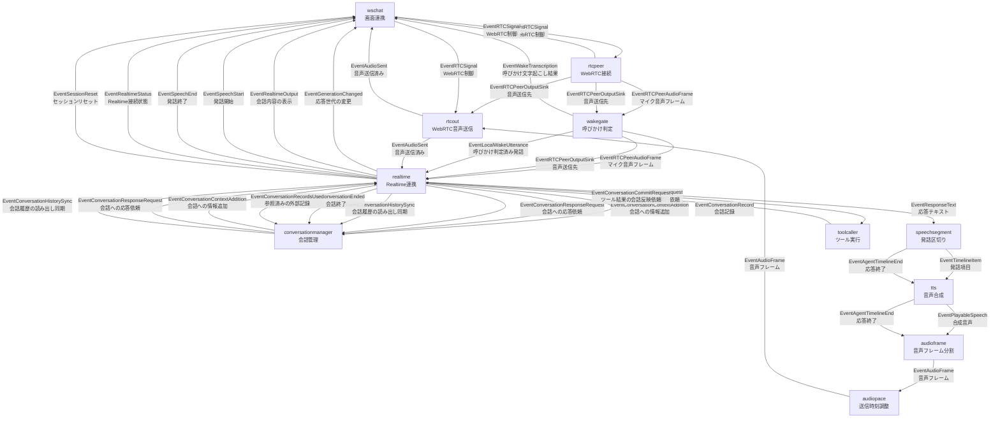

# コンポーネントとイベントの全体図

サーバーの `wireGraph` に登録された全11コンポーネントと、コンポーネント間で転送する全イベントを示します。
枠内は「コンポーネント名 → 日本語名」、矢印は「イベント名 → 日本語名」の2行表記です。
同じ送信元と送信先でも、イベントごとに矢印を分けています。

矢印はイベントの転送方向を表します。
条件付きで発行されるイベントも含めた接続定義なので、1回の会話ですべての矢印を通るとは限りません。
`EventAudioSent` は音声トラックへの書き込み成功を表し、ブラウザでの再生完了を表すものではありません。
`EventConversationHistorySync` は履歴を読み出す順序を揃えるためのイベントで、履歴本体は運びません。

この図の範囲は `graph.Stage` 間のイベント接続です。
外部APIへの通信、共有ストアの読み書き、HTTPハンドラーや予約ジョブからの入力は、グラフ外の処理です。

## 実装の参照先

- [コンポーネントの生成と接続定義（buildStages / wireGraph）](../cmd/smart-speaker/main.go)
- [イベントの転送処理（Graph）](../internal/graph/graph.go)
- [共通イベントとツール実行依頼](../internal/types/event.go)
- [Realtime、音声、呼びかけ関連のイベント](../internal/types/realtime.go)
- [会話管理のイベント](../internal/types/conversation_events.go)
- [音声送信と送信済みイベントの発行](../internal/components/rtcout/stage.go)
