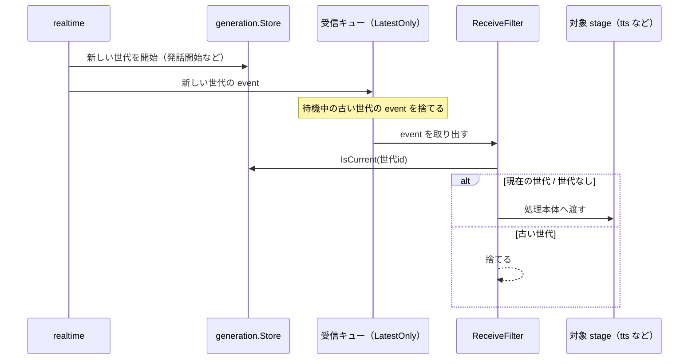

# generationfilter 概要理解ドキュメント

## 1. ビジネスコンテキスト

- **解決する課題**: ユーザーが割り込んで話し始めたあとも、古い応答の読み上げ・音声送信・画面表示が続いてしまうのを防ぐ。
- **提供価値**: 世代の判定を各 component の処理本体から切り離し、受信直後の接続部分に置く。これにより、`speechsegment`、`tts`、`audioframe` などは世代を意識せずに処理を書ける。
- **根拠コード**: `internal/components/generationfilter/connection.go`、`internal/graph/stage.go`、`internal/graph/graph.go`、`internal/states/generation/store.go`、`cmd/smart-speaker/main.go`。

## 2. 前提知識

- 世代idは `internal/states/generation.Store` が保持する。realtime がユーザーの発話開始、テキスト入力、切断のたびに新しい世代を始め、`EventGenerationChanged` を流す。
- event の payload が世代idを持つかどうかは、`types.EventGeneration(e)` で取り出す。
- `graph.Stage` には、受信まわりの設定が2つある。
  - `LatestOnly`: その stage の受信キューで、新しい世代の event が来たら古い世代の待機中 event を捨てる。
  - `ReceiveFilter`: キューから取り出した event を、処理本体へ渡す直前に判定する。`false` を返した event は処理本体に届かない。

## 3. 提供する関数

### `Attach(stage, store)`

- 対象 stage の `LatestOnly` を有効にし、`ReceiveFilter` で「現在の世代の event か、世代を持たない event だけを通す」判定を付ける。
- 通常起動では `speechsegment`、`tts`、`audioframe`、`audiopace`、`wschat`、`rtcout` に付ける（`cmd/smart-speaker/main.go` の `buildStages`）。
- 実行中の処理（たとえば合成中の音声1件）は止めないので、その1件分の待ち時間は残る。

### `AttachToolRequests(stage, store)`

- `toolcaller` に付ける。`LatestOnly` は無効のままにし、ツール要求を捨てずに1件ずつ判定する。
- 古い世代の `ToolRequest` は実行せず、`{"error":"interrupted before execution","executed":false}` という結果を `EventConversationCommitRequest` として下流（realtime）へ返す。結果が返らないまま realtime が待ち続けることを防ぐため。
- この結果を受け取ったAIは、ユーザーが取り消していなければ同じ呼び出しをやり直す（システムプロンプトの「ツールと結果」に書いている）。割り込みで操作を止める働きは残しつつ、話している最中に物音を拾っただけで依頼が消えないようにするため。
- 現在の世代の要求と、`ToolRequest` 以外の event はそのまま通す。

## 4. データフロー

