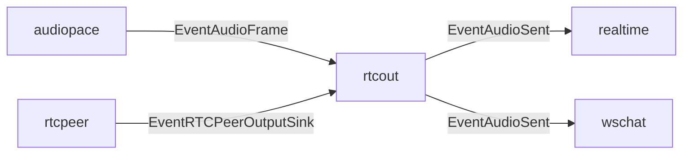

# rtcout component

`rtcout` は assistant の音声を WebRTC の下り audio track へ書き込む component。
signaling や peer 作成は `rtcpeer` が担当し、`rtcout` は接続済み peer の output sink に対して audio frame を投入する。

## 責務

- `audiopace` から、送信時刻の調整を終えた `EventAudioFrame`（24kHz・モノラル PCM16 の 20ms フレーム）を1つずつ受け取る。待機中の音声を内部に溜めない。
- WebRTC 側の 48kHz 音声に合わせて 2 倍 upsample する。
- peer の Opus channels が 2 の場合は stereo に upmix する。
- Opus frame に encode し、`rtcpeer` から通知された sink に書き込む。
- 書き込みに成功したフレームを `EventAudioSent` として下流（`realtime` と `wschat`）へ通知する。realtime は、実際に送信できたテキストを割り込み時の履歴補正に使う。
- `EventRTCPeerOutputSink` により peer の追加・削除を追従する。
- `EventRTCSignal` の `webrtc.volume` を受け取り、端末ごとの音量（0〜1.5 倍）を保持して送信時に掛ける。ブラウザは Web Audio の GainNode で音量を調整するため、二重の増幅を避けてサーバーへは 1 倍を送る（README の説明）。
- 受信直後に `generationfilter.Attach` を付けており、古い世代のフレームは送らない。

## 主な event

- 入力: `EventAudioFrame`、`EventRTCPeerOutputSink`、`EventRTCSignal`（音量）
- 出力: `EventAudioSent`

## 接続

