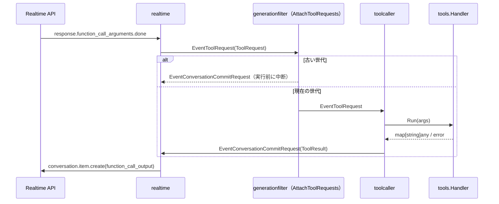

# toolcaller 概要理解ドキュメント

## 1. ビジネスコンテキスト

- **解決する課題**: Realtime API が返した function call を、local tool の実行へ橋渡しする。
- **提供価値**: tool の実行結果を realtime へ戻し、API への `function_call_output` と会話履歴の記録につなげる。UI に副作用を持つ tool（`set_whiteboard`）は、実行結果とは別の graph event で wschat へ通知できる。
- **責務の境界**: `toolcaller` は tool の実行と結果 event の発行だけを担う。function call の受け取り、結果の API への返却、会話履歴への記録、成功後に再び応答を生成するかの判断は `realtime` の責務。
- **通常起動での handler 登録**: `cmd/smart-speaker/main.go` の `buildToolRegistry` が local tool registry を構築し、`registry.Handlers()` と `registry.ToolModes()` を `toolcaller.NewStageWithHistory` に渡す。
- **根拠コード**: `internal/components/toolcaller/toolcaller.go`、`internal/components/generationfilter/connection.go`、`internal/components/realtime/events.go`、`cmd/smart-speaker/main.go`、`internal/tools/registry/registry.go`。

## 2. 論理構造・機能俯瞰

- **`toolcaller.NewStageWithHistory`**
  - handler map、tool mode map、ツール呼び出し履歴（`toolhistory.Store`）を受け取り、graph stage を作る。nil の map は空 map にする。
  - tool mode map は保持しているが、現在の処理では参照していない。

- **受信と実行**
  - `EventToolRequest` だけを処理し、payload が `types.ToolRequest` でなければ無視する。
  - request は受信した順に1件ずつ同期的に実行する。
  - 同じ `ToolCallID` の request が再び届いた場合は、tool を再実行せず、保存してある前回の結果を返す。
  - 実行の開始と終了を `toolhistory.Store` に記録する。画面の「ツール履歴」（`/?ui=tools`、`GET /api/tool-history`）はこの記録を表示する。

- **`tools.Handler`**
  - `Name() string` と `Run(args map[string]any) (map[string]any, error)` を持つ local tool の実体。`ToolRequest.Name` を key に検索する。

- **`tools.ContextAware` / `tools.EventEmitterAware`**
  - handler が実装していれば、stage の開始時に context と downstream への emitter を渡す。
  - `set_whiteboard`（`internal/tools/functions/whiteboard/tool.go`）は emitter を使い、`Run` の中で `EventWhiteboardUpdate` を出す。

## 3. 主要なデータフロー

### シナリオ: Realtime API の function call が実行され、結果が API へ戻るまで

1. Realtime API が `response.function_call_arguments.done` を返す。
2. realtime が tool 呼び出しを会話履歴に記録し、`types.ToolRequest` を `EventToolRequest` として出す。
3. toolcaller の受信直後に付けた `generationfilter.AttachToolRequests` が、request の世代を判定する。古い世代の request は実行せず、`{"error":"interrupted before execution","executed":false}` という結果を realtime へ返す。
4. 現在の世代なら、toolcaller が引数の JSON を decode して handler を実行する。
5. 結果を JSON にして `types.ToolResultRecord` を作り、`EventConversationCommitRequest` として realtime へ返す。成功・失敗、read 系・write 系を問わず、結果は必ず返す。
6. realtime が結果を会話履歴に記録し、`function_call_output` として API に返す。tool ごとの応答方針（`tools.DefinitionWithResponsePolicy`）に従い、必要なら `response.create` で再び応答を生成する。

### シナリオ: `set_whiteboard` がホワイトボードを更新する場合

1. toolcaller は stage の開始時に、`tools.EventEmitterAware` を実装する tool へ emitter を渡す。
2. `set_whiteboard` の `Run` の中で `EventWhiteboardUpdate` が出る。
3. `cmd/smart-speaker/main.go` の `wireGraph` で `toolcaller -> wschat` が `EventWhiteboardUpdate` で接続されている。
4. wschat が WebSocket の `{ "type": "whiteboard_update", "content": ... }` としてブラウザへ送る。
5. この event は実行結果とは別経路で、tool の実行結果（`EventConversationCommitRequest`）も通常どおり realtime へ返る。

## 4. 詳細設計

### エラー処理

- 引数の JSON decode error: handler を実行せず、`{"error":"invalid tool arguments"}` を結果にする。
- 未登録の tool: `{"error":"unknown function: <name>"}` を結果にする。
- handler error: `{"error":"<err.Error()>"}` を結果にする。
- 結果の JSON encode error: `{"error":"result encoding failed"}` を結果にする。
- stage の context がキャンセル済みの場合、event は送らずに終了する。

### Handler 登録

- `registry.Handlers()` は `handler.Name()` を key にした map を返す。handler が nil の entry は含まれない。
- `web_search` は `OPENAI_API_KEY` と `openai.responses_model` が registry に渡される通常起動で登録される。handler は `query` 以外の引数を拒否し、Responses API の hosted `web_search` の回答本文を `{"result":"..."}` として返す。
- SwitchBot の tool は、環境変数 `SWITCHBOT_TOKEN` と `SWITCHBOT_SECRET` がそろう場合だけ登録される。scene 一覧の取得に失敗した場合は `switchbot_execute_scene` だけが未登録になる。

### テーブル設計・API設計

該当なし。toolcaller が直接参照・更新する DB や外部 HTTP API はない。
