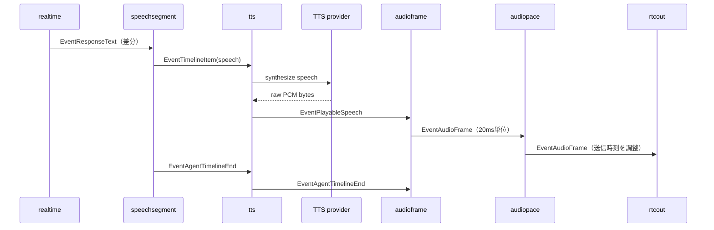

# tts 概要理解ドキュメント

## 1. ビジネスコンテキスト

* **解決する課題**: realtime が受け取った応答テキストを、スマートスピーカーで再生できる音声データへ変換する。
* **提供価値**: Realtime API からはテキストだけを受け取り、音声合成は VOICEVOX（既定）または ElevenLabs で行う。声やモデルを Realtime API の音声と切り離して選べる。
* **外部依存**: 起動時の provider は `config.yaml` の `tts.provider`（既定は `voicevox`）で決まる。画面の「読み上げ音声」や `PUT /api/tts` から切り替えることもでき、選択は全端末で共有する。
* **対象外**: 読み上げ単位への分割は前段の `speechsegment`、フレーム化・送信タイミング調整・WebRTC 送信は後段の `audioframe`・`audiopace`・`rtcout` の責務。

## 2. 論理構造・機能俯瞰

**主要なモデル・コンポーネント**

- **`tts.NewStage`**
  - `Config.Selector` があれば、音声を生成するたびに `Selector` が選んでいる provider を使う stage を作る（通常起動はこちら）。
  - `Selector` が無い場合は、`Config.Provider`（空なら `voicevox`）の provider に固定した stage を作る。

- **`tts.Selector`**
  - 起動時に `tts.provider` の provider を作り、もう一方の provider も設定がそろっていれば作っておく。
  - `Snapshot` で現在の選択と選べる候補を返し、`Select` で切り替える。設定がそろっていない provider は選べない。
  - 切り替えは次に生成する音声から反映し、合成中の音声は中断しない。サーバー再起動時は `tts.provider` の値に戻る。

- **`streamTTS`**
  - `EventTimelineItem` のうち `speech` を音声化し、`EventPlayableSpeech` として出す。`speech` 以外の `TimelineItem` はそのまま下流へ送る。
  - `EventAgentTimelineEnd`（1つの応答の読み上げ単位をすべて出し終えた印）は、そのまま下流へ送る。
  - 空白だけの `speech.Text` は provider に送らず、下流にも送らない。

- **`types.PlayableSpeech`**
  - 音声化した読み上げ単位。`GenerationID`、`SequenceID`、`Text`、base64 化した PCM 音声 `Audio`、推定再生時間 `DurationSeconds`、元の `TimelineItem`（`OriginalTimeline`）を持つ。

## 3. 主要なデータフロー

### シナリオ: 応答テキストが音声になり、ブラウザへ送られるまで

1. **realtime が応答テキストを流す**: Realtime API の `response.output_text.delta` を、`EventResponseText` として流す。
2. **speechsegment が読み上げ単位に分割する**: 句点などで区切り、`TimelineItem{Kind: "speech"}` を `EventTimelineItem` として流す。応答の終わりで `EventAgentTimelineEnd` を出す。
3. **tts が音声化する**: 選択中の provider を呼ぶ。ElevenLabs は `POST https://api.elevenlabs.io/v1/text-to-speech/{voice}/stream?output_format=pcm_24000`、VOICEVOX は `/audio_query` と `/synthesis` を使う。
4. **PlayableSpeech を出力する**: 24kHz / 16bit / mono の PCM を base64 にして、`EventPlayableSpeech` として流す。
5. **後段が送信する**: `audioframe` が 20ms 単位のフレームに分割し（`OriginalTimeline.ItemID` で応答を識別する）、`audiopace` が送信時刻を調整し、`rtcout` が Opus に変換して WebRTC で送る。

各 stage の受信直後には `generationfilter.Attach` を付けているので、割り込みで世代が進むと、古い世代の読み上げ単位や音声は処理されずに捨てられる。

## 4. 詳細設計

### クラス設計

- internal/
  - components/
    - tts/
      - provider.go: provider 選択、共通 PCM 契約、duration 算出を定義する。
        - `NewStage`: `Config.Selector` があれば選択中の provider を毎回参照する stage を、無ければ `Config.Provider` の provider に固定した stage を作る。
        - `ttsDurationSeconds`: PCM byte 数から秒数を算出し、0.5 秒の再生後 padding を加算する。0 byte 以下は 0 秒。
      - stage.go: provider 非依存の TTS stage 実装。
        - `(*streamTTS).run`: upstream から event を読み、`EventTimelineItem` のうち `speech` だけを音声化する。それ以外の `TimelineItem` と `EventAgentTimelineEnd` はそのまま emit する。
        - `(*streamTTS).emit`: context cancellation を見ながら downstream へ event を送る。
        - `(*streamTTS).handleSpeech`: provider の結果から `types.PlayableSpeech` を組み立て、`EventPlayableSpeech` を出力する。
        - `(*streamTTS).close`: upstream channel を一度だけ close する。
      - elevenlabs.go: ElevenLabs provider の実装。
        - `(*elevenLabsSynthesizer).SynthesizeSpeech`: ElevenLabs API を呼び、raw PCM を返す。
        - `(*elevenLabsSynthesizer).buildVoiceSettings`: voice settings のデフォルト値と設定値を合成し、API payload 用の map を作る。
        - `normalizeStability`: `eleven_v3` 系 model の stability を `0`、`0.5`、`1` のいずれかへ丸める。
      - voicevox.go: VOICEVOX provider の実装。
        - `(*voicevoxSynthesizer).SynthesizeSpeech`: `/audio_query` と `/synthesis` を呼び、WAV response から raw PCM を返す。
      - wav.go: WAV header を検証し、24kHz / 16bit / mono PCM の `data` chunk を取り出す。
      - selector.go: 選択中の provider を全端末で共有し、`GET` / `PUT /api/tts` の処理に使う。

- internal/
  - types/
    - timeline_item.go: `TimelineItem` と `PlayableSpeech` を定義する。
    - event.go: `EventTimelineItem`（入力）、`EventPlayableSpeech`（出力）、`EventAgentTimelineEnd` を定義する。

### ElevenLabs 呼び出し設計

- **URL**: `https://api.elevenlabs.io/v1/text-to-speech/{voice}/stream?output_format=pcm_24000`
- **HTTP method**: `POST`
- **headers**
  - `Content-Type: application/json`
  - `xi-api-key: {Config.APIKey}`
- **request body**
  - `text`: `TimelineItem.Text`
  - `model_id`: `Config.Model`
  - `language_code`: 固定で `ja`
  - `voice_settings`: `buildVoiceSettings` の結果
- **response**
  - 300 番台以上の status の場合、body を読んで `"{status}: {body}"` 形式の error にする。
  - 成功時は response body 全体を raw PCM byte として読み込む。
  - raw PCM は共通 stage で base64 encode され、`PlayableSpeech.Audio` に入る。

### VOICEVOX 呼び出し設計

- **endpoint**: `tts.voicevox.endpoint`
- **audio query**: `POST /audio_query?text={text}&speaker={speaker_id}`
- **synthesis**: `POST /synthesis?speaker={speaker_id}`
- **speedScale**: `tts.voicevox.speed_scale` が指定されている場合だけ、`/audio_query` response JSON の `speedScale` を上書きする。未指定時は engine の query 結果を尊重する。
- **response**
  - `/synthesis` の response は WAV として扱う。
  - WAV は 24kHz / 16bit / mono PCM の場合だけ受け入れる。
  - PCM 以外、24kHz 以外、16bit 以外、mono 以外、`data` chunk 不在の場合はエラーにする。
  - 初回実装ではリサンプリングしない。

### Voice Settings

- デフォルト値は `stability: 1.0`、`similarity_boost: 0.8`、`speed: 1.2`、`use_speaker_boost: true`。
- `Config.VoiceSettings` が指定されている場合、ゼロ値ではないフィールドだけデフォルトを上書きする。
- `Style` は 0 でない場合だけ `voice_settings.style` に含める。
- `Speed` は 0 でない場合だけ `voice_settings.speed` に含める。
- `UseSpeakerBoost` は nil でない場合だけ設定値を使う。デフォルトでは true が入る。
- `model_id` が `eleven_v3` で始まる場合、`stability` は `0`、`0.5`、`1` の三値に正規化される。閾値は `0.25` 未満が `0`、`0.75` 未満が `0.5`、それ以上が `1`。

### Duration 算出

- provider の共通出力契約は 24kHz / 16bit / mono PCM。
- ElevenLabs の出力形式は URL query で `pcm_24000` に固定されている。
- VOICEVOX の WAV response は TTS component 内で 24kHz / 16bit / mono PCM として検証する。
- 実装上の前提は `sample rate = 24000`、`bytes per sample = 2`、`channels = 1`。
- 算出式は `duration_seconds = raw_pcm_bytes / (24000 * 2 * 1) + 0.5`。
- raw byte 数が 0 以下の場合は 0 秒。
- この duration は現在、ログ出力（`tts duration=...`）にだけ使われている。実際の送信間隔は `audiopace` がフレームごとに決める。

### エラー・破棄条件

- `NewStage` は未知の provider をエラーにする。
- `elevenlabs` provider は API key または voice id が空ならエラーにする。
- `voicevox` provider は endpoint が空、speaker id が負数、speed scale が 0 以下の場合にエラーにする。
- `run` は `EventTimelineItem` と `EventAgentTimelineEnd` 以外の event を無視する。
- payload が `types.TimelineItem` でない場合も無視する。
- `speech.Text` が空白だけの場合は provider を呼ばず、下流にも event を出さない。
- provider 呼び出し、response body 読み込み、JSON marshal、request 作成、WAV 検証でエラーになった場合は、context cancellation でなければログに出し、その speech は下流へ出さない。

### 接続設計

- 本番起動時は `cmd/smart-speaker/main.go` で `tts.NewSelector` と `tts.NewStage` が呼ばれ、`tts.provider`、ElevenLabs 設定、VOICEVOX 設定が渡される。
- VOICEVOX service の起動と設定は [docs/services/voicevox.md](/docs/services/voicevox.md) を参照する。
- graph 接続は `speechsegment -> tts -> audioframe` の順で、`EventTimelineItem`・`EventAgentTimelineEnd` を受け取り、`EventPlayableSpeech`・`EventAgentTimelineEnd` を渡す。

### 不明点

- ElevenLabs API と VOICEVOX API の外部仕様そのものは本ドキュメントでは検証していない。URL、payload、PCM 前提は現行実装に基づく。

## 参照元

- [internal/components/tts/elevenlabs.go](/internal/components/tts/elevenlabs.go)
- [internal/components/tts/provider.go](/internal/components/tts/provider.go)
- [internal/components/tts/stage.go](/internal/components/tts/stage.go)
- [internal/components/tts/voicevox.go](/internal/components/tts/voicevox.go)
- [internal/components/tts/wav.go](/internal/components/tts/wav.go)
- [internal/components/tts/elevenlabs_test.go](/internal/components/tts/elevenlabs_test.go)
- [internal/types/timeline_item.go](/internal/types/timeline_item.go)
- [internal/types/event.go](/internal/types/event.go)
- [internal/types/types.go](/internal/types/types.go)
- [internal/components/tts/selector.go](/internal/components/tts/selector.go)
- [internal/components/speechsegment/stage.go](/internal/components/speechsegment/stage.go)
- [internal/components/audioframe/stage.go](/internal/components/audioframe/stage.go)
- [cmd/smart-speaker/main.go](/cmd/smart-speaker/main.go)
