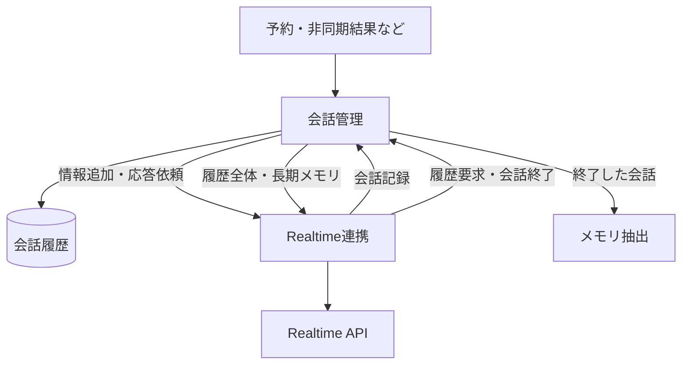

# 会話管理

会話管理コンポーネント（`conversationmanager`）が会話履歴ストアを所有し、既存の `types.Event` を使ってRealtime連携と接続する。
音声の受け渡し、接続、割り込み、実際に話した内容の確定はRealtime連携が担当する。

| イベント | 保存 | API側の扱い |
| --- | --- | --- |
| `EventConversationRecord` | 記録・更新 | APIへ送り返さない |
| `EventConversationContextAddition` | 保存して引き渡す | 接続中ならすぐに追加し、応答は開始しない |
| `EventConversationResponseRequest` | 保存して引き渡す | 必要なら接続し、文脈の反映後に応答する |

応答の依頼はイベントの種類で表し、履歴ストアに保存しない。
ブラウザが未接続でも応答依頼は処理する。
情報追加だけではAPIへの接続を開始せず、次の接続時の履歴復元で反映する。
既存の非同期通知は会話管理の入口で変換し、`delivery: history_only` は情報追加、それ以外は応答依頼として扱う。
通知方針は保存するメタデータから取り除くが、呼び出しや予約の識別情報は維持する。

接続時はイベントで履歴と長期メモリを取得する。
Realtime側で古い記録から除き、復元用の文章を既定24,000バイトの予算内へ絞る。
復元した履歴と長期メモリはシステム指示へ混ぜず、接続確立後に参考記録として会話へ追加する。
これはトークナイザーによる厳密な上限計算ではなく、指示やツール定義用の余裕を残す保守的な目安である。
長期メモリはそのまま引き継ぎ、ストアの履歴は削除しない。
文字起こしやAI応答の記録を新しい入力として再送せず、未送信の生成文も文脈へ復元しない。

会話終了はRealtime連携が判断し、会話管理へ通知する。
会話管理は終了した履歴を切り出してメモリ抽出へ渡し、まだ応答で利用していない外部入力は残す。
利用済みの通知はAPIが応答開始を返した時点で行う。
失敗した応答要求の再試行は追加しない。

イベント購読基盤は [#360](https://github.com/tetetratra/smart-speaker/issues/360)、会話の保持期間の変更は [#368](https://github.com/tetetratra/smart-speaker/issues/368) で扱う。
