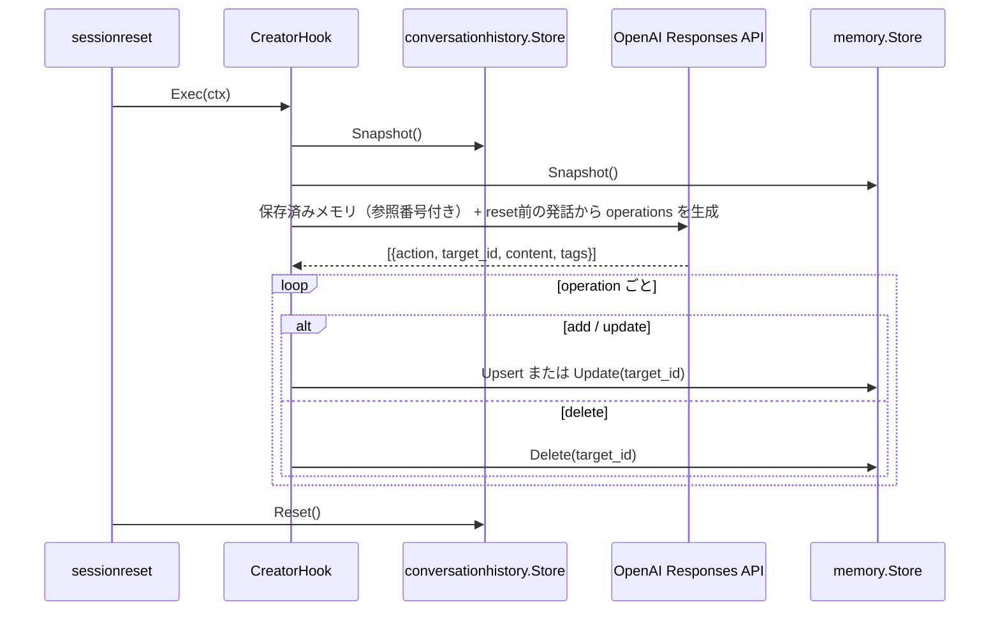
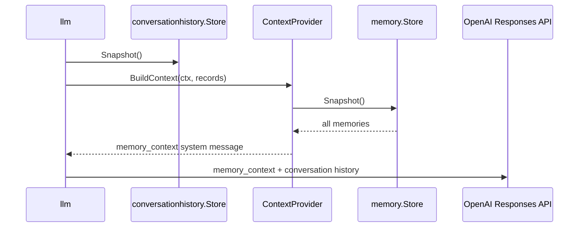
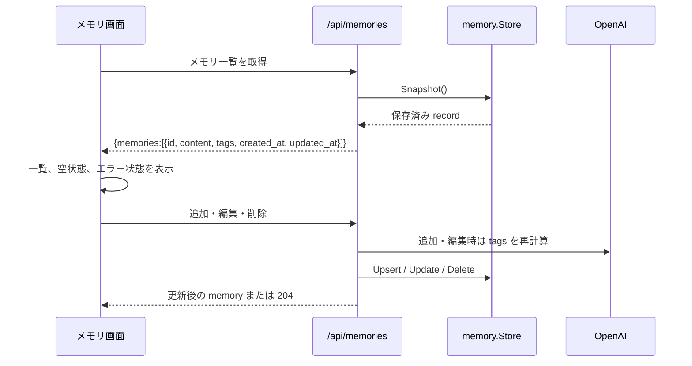

# memory hook 概要理解ドキュメント

## 1. ビジネスコンテキスト

- **解決する課題**: 会話から抽出した長期記憶を、後続の発話で LLM が参照できる土台を用意する
- **ターゲットユーザー**: smart-speaker を利用するユーザーと、メモリ機能を実装・保守する開発者
- **価値定義**: JSON file store に保存したメモリを LLM へ全件注入しつつ、メモリ作成時に LLM が保存済みメモリを見て重複・陳腐化を防げる

## 2. 論理構造・機能俯瞰

**主要なモデル・コンポーネント**

- **`internal/hooks/memory.OpenAIClient`**
  - reset 前の会話履歴と保存済みメモリを OpenAI Responses API に渡し、メモリへの変更操作を structured output として生成する
  - 会話履歴はユーザーとアシスタントの発話（`user` / `agent`）だけを渡し、ツール呼び出し・ツール結果・system メッセージと metadata は渡さない
  - 操作（`Operation`）は `action`（`add` / `update` / `delete`）、`target_id`、`content`、`tags[]` を持つ
  - 会話の `created_at` は日本時間（`+09:00`）で渡す
  - 手動入力されたメモリ本文から検索補助用の `tags[]` だけを structured output として生成する
  - 通常起動では `OPENAI_MEMORY_MODEL` を使い、未指定の場合は `OPENAI_RESPONSES_MODEL` に fallback する
  - 1 reset あたりの操作数は最大 5 件（環境変数では変更できない）、1 件あたりの tag は既定で最大 5 件（`MEMORY_MAX_TAGS`）
  - ユーザーとアシスタントの発話が無い場合は OpenAI API を呼ばず、操作なしとして返す
- **`internal/hooks/memory.CreatorHook`**
  - `sessionreset.Hook` として reset 前に同期実行される
  - 会話終了時は `ExecRecords` が終了時点で固定した会話を受け取る。`Exec` は `conversationhistory.Store.Snapshot()` から履歴を読んで `ExecRecords` を呼ぶ
  - `memory.Store.Snapshot()` から保存済みメモリを読み、store の ID の代わりに `"1"`, `"2"` … の短い参照番号を付けて `OpenAIClient` に渡す。LLM が長い ID を書き写し間違えるのを防ぐためで、Mem0 と同じ手法
  - `add` は `memory.Store.Upsert` に保存を委譲する
  - `update` は `memory.Store.Update` で `target_id` の記憶を置き換える。更新後の本文が別の記憶と同じになる場合は、重複を作らないよう対象を削除する
  - `delete` は `memory.Store.Delete` で `target_id` の記憶を削除する
  - 存在しない参照番号を指す操作、同じ記憶への2件目以降の操作は適用しない
  - 適用順は delete → update → add。更新・追加の重複判定が、同じ実行で消える記憶を根拠にして両方を失うのを防ぐ
  - LLM の応答を待つ間に管理画面から編集・削除された記憶（`updated_at` が変わった、または消えた記憶）への操作は、手動の変更を優先して適用しない
  - 操作の生成全体に失敗した場合は error を返す
  - 操作単位の失敗・スキップは残りの処理を継続し、最後に error を集約して返す
- **`internal/states/memory.Store`**
  - メモリ本文、タグ、作成・更新時刻を JSON file に永続化する
  - 前後の空白と英字の大文字小文字を無視して同じ本文だけを重複として扱い、重複した追加は既存 record を更新せず保存をスキップする
  - 旧形式の JSON に残っている `embedding` は読み込み時に無視し、次回保存時に消える
  - ID 指定で本文、タグ、更新時刻を置き換える
  - ID 指定で record を削除する
- **`internal/hooks/memory.ContextProvider`**
  - `memory.Store.Snapshot()` から保存済みメモリを全件取得する
  - メモリ本文だけを `memory_context` system message として LLM の入力に追加する
- **`GET /api/memories`**
  - 管理画面から保存済みメモリ一覧を確認するための HTTP API
  - 会話処理と同じ `memory.Store` インスタンスの `Snapshot()` から一覧を取得する
  - レスポンスには `id`、`content`、`tags`、`created_at`、`updated_at` を含める
- **`POST /api/memories`, `PUT /api/memories/{id}`, `DELETE /api/memories/{id}`**
  - 管理画面から保存済みメモリを手動追加・編集・削除するための HTTP API
  - 追加・編集時は `manualMemoryService` が本文からタグを再計算してから store を更新する
  - 削除時は ID 指定で store から record を削除する
- **メモリ画面**
  - 通常画面の「メモリ」ボタンから遷移する専用画面
  - 表示時に `GET /api/memories` を呼び出し、その時点のメモリ一覧を表示する
  - ユーザー入力によるメモリ文の追加、保存済みメモリ本文のインライン編集、保存済みメモリの削除ができる
  - WebSocket やポーリングによるリアルタイム更新は行わない

## 3. 設定

通常起動では、メモリ機能の設定を環境変数から読み込みます。

| 環境変数 | 既定値 | 用途 |
| --- | --- | --- |
| `OPENAI_MEMORY_MODEL` | `OPENAI_RESPONSES_MODEL` | reset 前履歴からメモリ操作を作る Responses API の model |
| `MEMORY_STORE_PATH` | `data/memories.json` | メモリ JSON file store の保存先 |
| `MEMORY_MAX_TAGS` | `5` | メモリ 1 件あたりの最大 tag 数 |

Docker Compose では `MEMORY_STORE_PATH=/app/data/memories.json` を server に渡します。
`/app/data` は host の `/var/lib/smart-speaker/data` に volume mount されるため、メモリ JSON はコンテナ再作成後も保持されます。

## 4. 主要なデータフロー

### シナリオ: session reset 前の会話からメモリを追加・更新・削除する

1. reset 発火: `sessionreset` が idle timeout 到達時に登録済み hook を reset 前に実行する。
2. 履歴取得: `CreatorHook` が `conversationhistory.Store.Snapshot()` で reset 前履歴を取得する。
3. 操作生成: `OpenAIClient` が保存済みメモリ（参照番号と `content`）と、ユーザー・アシスタントの発話だけに絞った会話を JSON 文字列として Responses API に送り、`action`、`target_id`、`content`、`tags[]` を持つ操作の配列を受け取る。
4. 正規化: `add` / `update` で空の `content`、`update` / `delete` で空の `target_id`、未知または空の `action` は除外し、`tags` は trim、空文字除外、大文字小文字を無視した重複除外、最大件数で切り詰める。
5. 適用: `CreatorHook` が参照番号を store の ID に戻し、`add` は `memory.Store.Upsert`、`update` は `memory.Store.Update`、`delete` は `memory.Store.Delete` で適用する。存在しない参照番号、同じ記憶への2件目以降の操作、生成中に手動で変更された記憶への操作はスキップする。
6. reset 継続: hook が error を返しても、`sessionreset` の既存仕様により履歴 reset、世代更新、agent status idle 化は継続される。



### シナリオ: 保存済みメモリを全件取得して LLM に注入する

1. user 発話が履歴へ保存される。
2. `llm` が応答生成前に保存済み履歴 snapshot を読む。
3. `ContextProvider` が `memory.Store.Snapshot()` から保存済みメモリを全件取得する。
4. `llm` が全メモリの `content` を `memory_context` system message として通常の会話履歴より前に追加する。



### シナリオ: 管理画面から保存済みメモリを確認・手動更新する

1. 通常画面で「メモリ」ボタンを押す、または `?ui=memory` / `/memory` で Web UI を開く。
2. フロントエンドがメモリ画面へ切り替わったタイミングで `GET /api/memories` を呼び出す。
3. HTTP handler が会話処理と共有している `memory.Store` の `Snapshot()` を取得する。
4. handler が `created_at` 降順に並べ、`id`、`content`、`tags`、`created_at`、`updated_at` に絞った JSON を返す。
5. フロントエンドが本文、タグ、作成日時、更新日時を表示する。
6. 追加・編集時は `POST /api/memories` または `PUT /api/memories/{id}` を呼び出し、入力されたメモリ文からタグを再計算して保存する。
7. 削除時は `DELETE /api/memories/{id}` を呼び出し、該当 record を store から削除する。



## 5. 失敗時の扱い

- メモリ操作の生成で OpenAI Responses API が失敗した場合、`CreatorHook` は error を返しますが、`sessionreset` は error をログに残して reset 処理を継続します。
- 操作単位の保存・更新・削除に失敗した場合や、上記の理由で操作をスキップした場合、`CreatorHook` は残りの処理を継続し、最後に error を集約して返します。
- store file が読めない、または不正な version の JSON がある場合は通常起動時の store 初期化に失敗します。
- `GET /api/memories` が `memory.Store` を参照できない場合は 500 を返します。
- 手動追加・編集でタグ生成に失敗した場合は 500 を返し、store は更新しません。
- 手動編集・削除で対象 ID が見つからない場合は 404 を返します。
- メモリ画面で一覧取得や保存操作に失敗した場合は、画面内にエラーを表示します。

## 6. 詳細設計

### クラス設計

- `internal/`
  - `hooks/`
    - `memory/`
      - `openai_client.go`: reset 前会話履歴からメモリ操作を生成する
        - `NewOpenAIClient`: API key、model、endpoint、HTTP client、最大操作数、最大 tag 数を受け取る
        - `CreateOperations`: 履歴をユーザー・アシスタントの発話に絞り、空なら操作なしを返す。発話があれば保存済みメモリと一緒に Responses API の strict JSON schema で変更操作を生成する
        - `CreateTags`: 手動入力本文からタグだけを Responses API の strict JSON schema で生成する
        - `memoryOperationInstructions`: 保存基準、操作の使い分け、出力例を定義する
        - `normalizeOperations`: action ごとの必須項目の検証、`tags` の trim / 重複除外 / 件数制限を行う
      - `creator_hook.go`: session reset 前にメモリ操作を生成して適用する hook を担当する
        - `NewCreatorHook`: history、operation creator、memory store を受け取り、必須依存の nil を拒否する
        - `ExecRecords`: 保存済みメモリの snapshot に参照番号を付け、操作生成、参照番号の解決、Store への add / update / delete を順に実行する
        - `Exec`: 会話履歴 store の snapshot で `ExecRecords` を呼ぶ
        - 操作単位の失敗は `errors.Join` で集約しつつ、残りの処理を続ける
      - `context_provider.go`: LLM 応答生成前のメモリ注入を担当する
        - `BuildContext`: 保存済みメモリを全件取得し、本文だけを `memory_context` system message にする
  - `cmd/`
    - `smart-speaker/`
      - `http_server.go`: HTTP server と mux の構築、共通 JSON 応答、server 起動・終了を担当する
      - `memory_http.go`: `/api/memories` の routing、request decode、response DTO、error mapping を担当する
      - `manual_memory_service.go`: 手動追加・編集時のタグ生成、store 更新と、手動削除時の store 削除を担当する
      - `web_ui.go`: Web UI の静的ファイル配信と SPA fallback を担当する
  - `states/`
    - `memory/`
      - `store.go`: メモリ record の永続化と重複判定を担当する
        - `Upsert`: 前後の空白と英字の大文字小文字を無視して同じ本文かで重複を判定し、重複していなければ保存する。重複時は既存 record を更新しない
        - `Update`: ID 指定で content、tags を更新し、作成日時を維持して更新日時を更新する
        - `Delete`: ID 指定で record を削除する

### API設計

- `POST https://api.openai.com/v1/responses`: reset 前会話履歴からメモリ操作を生成する
  - system input: 保存基準、操作の使い分け、出力例
  - user input: `{ "existing_memories": [{ "id": 参照番号, "content" }], "conversation": [{ "role", "text", "created_at" }] }` を JSON 文字列化したもの
  - structured output schema: `{ "operations": [{ "action": "add"|"update"|"delete", "target_id": string, "content": string, "tags": string[] }] }`
  - 変更なしは `{ "operations": [] }` として扱う
- `GET /api/memories`: 管理画面向けに保存済みメモリ一覧を取得する
  - リクエスト: なし
  - レスポンス: `{"memories":[{"id":"...","content":"...","tags":["..."],"created_at":"...","updated_at":"..."}]}`
  - `created_at` 降順で返す
- `POST /api/memories`: 管理画面向けにメモリを手動追加する
  - リクエスト: `{"content":"保存するメモリ文"}`
  - レスポンス: `{"memory":{"id":"...","content":"...","tags":["..."],"created_at":"...","updated_at":"..."}}`
  - 入力本文から tags を再計算して保存する
- `PUT /api/memories/{id}`: 管理画面向けにメモリ本文を編集する
  - リクエスト: `{"content":"更新後のメモリ文"}`
  - レスポンス: `{"memory":{"id":"...","content":"...","tags":["..."],"created_at":"...","updated_at":"..."}}`
  - 入力本文から tags を再計算し、作成日時は維持して更新日時を更新する
- `DELETE /api/memories/{id}`: 管理画面向けにメモリを削除する
  - リクエスト: なし
  - レスポンス: なし

### メモリ操作の生成ルール

- 保存するかは「数週間後の別の会話で、これを知っていると応答が明確に良くなるか」で判断し、迷ったら保存しない。多くの会話では空配列が正解とする。
- 保存してよいもの: ユーザー本人が話した長く変わらないプロフィール、好き嫌いや関心、繰り返す習慣、応答の仕方についての希望。
- 保存しないもの:
  - アシスタントやシステムが既に分かること（日本語で話す、音声で話しかける、タイムゾーン、アシスタントに連携済みのサービス・家電やそのシーン名）
  - その場限りの依頼や出来事、「〜をよく尋ねる」のような利用傾向
  - アシスタント自体の動作確認・開発・テストの話
  - アシスタントの発言だけを根拠にした推測、会話ログの生コピー、秘密情報らしき内容
- ユーザーが「覚えておいて」と明示した内容は保存し（パスワードなどの秘密情報は除く）、「忘れて」と言った内容は `delete` する。
- 同じ話題が既にあれば `add` せず `update` で1件にまとめる。好みや状況が変わった場合も `delete` ではなく新しい内容への `update` にする。
- `delete` は「もう当てはまらない」「間違っている」と言われ、置き換える内容がない記憶だけに使う。1つの記憶への操作は1件まで。
- `content` は1件1話題で「ユーザーは」で始まる短い自然文にし、相対的な日時は会話の `created_at` を基準に絶対日付にする。

例:

```json
{
  "operations": [
    {
      "action": "update",
      "target_id": "1",
      "content": "ユーザーは横浜に住んでいる",
      "tags": ["location", "横浜"]
    },
    {
      "action": "add",
      "target_id": "",
      "content": "ユーザーは雨の日に頭痛が出やすい",
      "tags": ["health", "weather", "rain", "headache"]
    }
  ]
}
```

### 現時点の対象外

- メモリ一覧のリアルタイム更新
- メモリ store の migration
